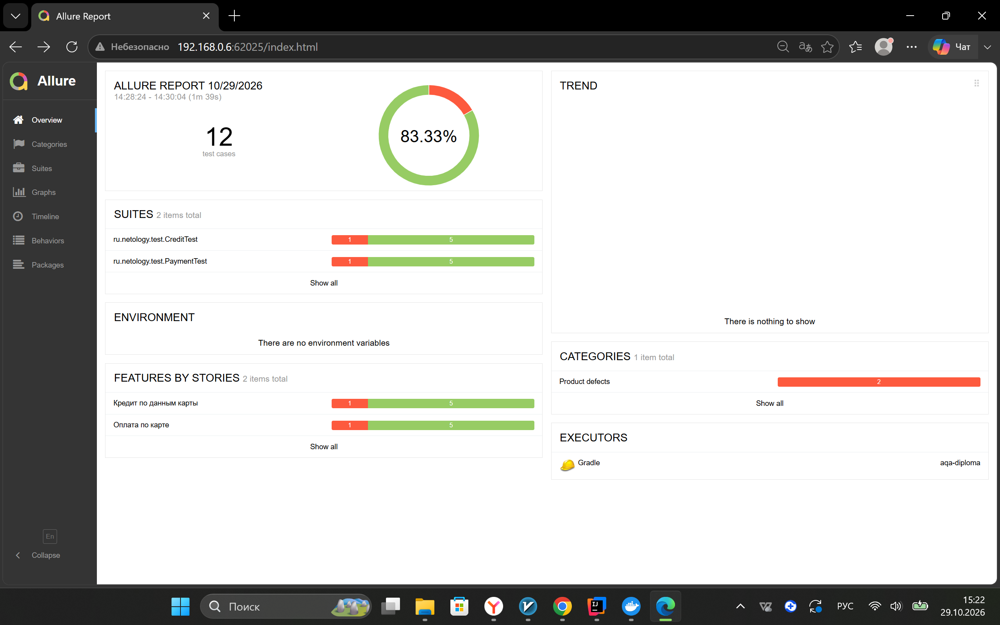
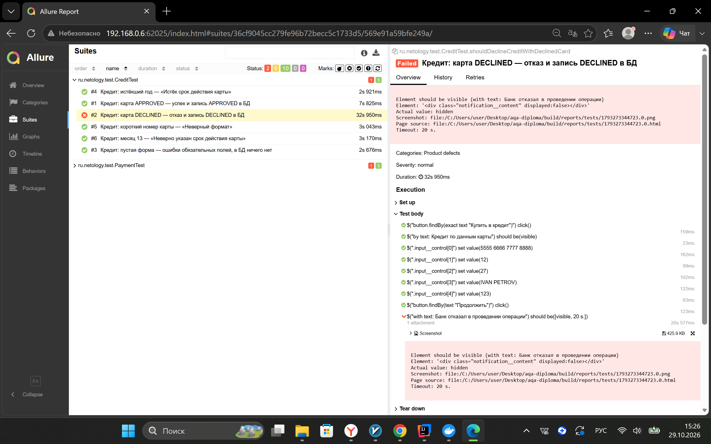
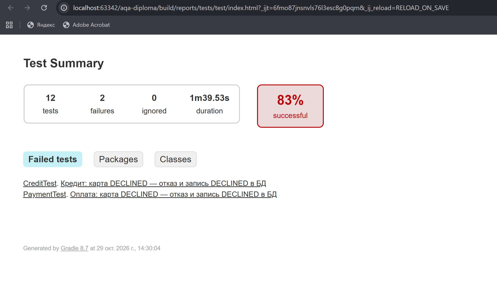
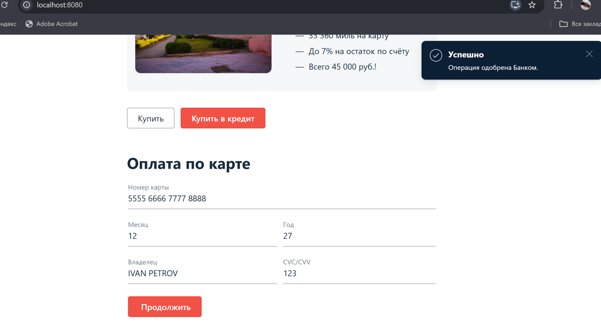

# Отчёт о проведённом тестировании

## Краткое описание

Протестирован веб-сервис покупки тура (оплата картой и кредит по данным карты). Проверены UI-сценарии обеих форм, корректность записей в БД (MySQL), валидация полей. Прогон выполнен на локальной заглушке банковского симулятора, потому что настоящий симулятор (185.119.57.197:9999) недоступен из моей сети. Найденный дефект оформлен в issue.

## Количество тест-кейсов

Всего автоматизированных тест-кейсов: 12 (по 6 на каждую форму: успешная операция, отказ банка, пустая форма, короткий номер карты, истёкший год, месяц 13).

## Результаты

- Успешных: 10 (83%).
- Неуспешных: 2 (17%): отказ банка в форме оплаты и в форме кредита.

Подробности: Allure-отчёт и Gradle-отчёт.

## Найденные дефекты

1. [Issue 1](https://github.com/iraczar/aqa-diploma/issues/1): при отказе банка пользователю показывается «Операция одобрена Банком». Статус DECLINED в БД записывается верно.

## Рекомендации

1. Исправить дефект из issue до выхода в продакшн.
2. Строго валидировать поля формы на фронтенде и на бэкенде.
3. Ввести стабильные `data-test-id` у элементов формы для автотестов.
4. Хранить данные для подключения к БД в конфигурации окружения, а не в коде.
5. Подключить CI для регулярного прогона тестов.
6. Повторить прогон на настоящем симуляторе банка, когда он будет доступен.